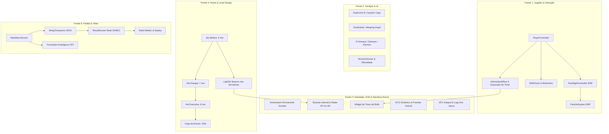

# SOMBRA DA SANIDADE // PLANO DE ENGENHARIA & DESIGN — RELEASE CANDIDATE (RC)
> **Projeto:** Sombra da Sanidade  
> **Marco:** Entrega 3 — Versão Final / Release Candidate (2ª VA — 1.000 Pontos)  
> **Prazo Impreterível:** 23 de Novembro de 2026, às 19:59  
> **Engine:** Unity 6000.5.10f1 (DirectX 11 / 2D URP)  
> **Alvo:** WebGL (GitHub Pages) e Executável Desktop x64  
> **Documento de Referência:** GDD v1.1, Diretrizes da Disciplina de Jogos Digitais e Validações de Playtest  

---

## 1. VISÃO GERAL & DEFINITION OF DONE (DoD) DO RELEASE CANDIDATE

Este documento formaliza as especificações técnicas, arquiteturais e de gameplay para a conclusão da versão **Release Candidate (RC)**. Ele integra os critérios avaliativos da 2ª VA (1.000 pontos) com os refinamentos diretos levantados nas sessões de playtest com a banca/professor. Qualquer desenvolvedor ou módulo autônomo trabalhando no repositório deve tratar as especificações deste documento como contratos estritos de implementação e critérios de aceitação.

### 1.1 Metas Mandatórias da Entrega 3
1. **Duração e Pacing:** Mínimo de **20 minutos de gameplay contínuo**, estruturado em **3 fases/alas distintas** com **5 a 7 minutos cada**, mais a sequência de fuga do clímax.
2. **Ciclo Completo de Jogo:** Menu Principal $\to$ Briefing $\to$ Nível 1 (Ala Médica) $\to$ Transição $\to$ Nível 2 (Ala de Energia) $\to$ Transição $\to$ Nível 3 (Ala Executiva) $\to$ Eclusa de Fuga $\to$ Tela de Vitória com Laudo de Auditoria (Ranks S/A/B/C) ou Game Over com causa específica e reinício rápido.
3. **Mecânica Reativa & Combate Tático:** PC capaz de alterar o ambiente e repelir/atordoar NPCs através de luz, sombras, disjuntores e descarga EMP com efeitos de partícula.
4. **Variedade de Ameaças:** Presença de **pelo menos 3 ameaças/inimigos com comportamentos distintos** (Espécime B, Sonâmbulo e Câmeras de Vigilância / Alucinações Físicas) com 3 perfis de dificuldade.
5. **Sonoplastia Completa:** Feedback auditivo para todas as ações do jogador (coleta de itens, dano/estresse, vitória, derrota, trilha de tensão/drone ambiente).
6. **Efeitos Visuais e Transições:** Transições analógicas CRT entre cenas e sistemas de partículas 2D aplicados em eventos-chave de interação e combate.
7. **Artefatos Externos de Avaliação:**
   - Deploy público jogável via WebGL (GitHub Pages).
   - Vídeo completo de gameplay no YouTube ($\ge 20$ minutos).
   - Deck de slides para defesa presencial (`docs/apresentacao/sombra-da-sanidade-pitch.pptx`).
   - Relatórios individuais de contribuição técnica por membro da equipe.

---

## 2. INCORPORAÇÃO DAS DEMANDAS DE PLAYTEST (DIRETRIZES DA BANCA)

A avaliação da jogabilidade apontou 4 pontos cruciais de atrito (*pain points*) que devem ser absorvidos de forma prioritária, sendo quase todos resolvidos centralmente através da **Frente 3 (HUD, Sanidade e Narrativa)**:

```
DEMANDAS DE PLAYTEST ──► RESOLUÇÃO CENTRAL PELA FRENTE 3 (HUD & SANIDADE)
├── 1. HUD do relógio visível o tempo todo ──► Smartwatch permanentemente acoplado (Docked)
├── 2. Bússola / Sinalização dos HDs        ──► Sensor RF de proximidade + Bússola vetorial no relógio
├── 3. Alerta de término de buffs           ──► Widget de contagem regressiva + bipe rítmico no HUD
└── 4. Percepção de alta dificuldade        ──► Eliminação da desorientação e clareza de telemetria
```

1. **HUD do Relógio Permanente na Tela:**
   - *Problema:* O relógio só abria segurando `Tab`, o que reduzia a velocidade de Thomas para 55% e deixava o jogador desinformado durante fugas.
   - *Solução:* O Smartwatch tático fica **permanentemente acoplado no canto inferior direito** da tela, renderizando o ECG, o BPM, a pressão arterial e a bateria em tempo real, sem penalizar a velocidade do jogador.
2. **Localização e Wayfinding dos Servidores de HD:**
   - *Problema:* O jogador ficava desorientado no escuro sem saber onde estavam os servidores.
   - *Solução:* Integração de uma **Bússola Forense / Radar RF** no próprio Smartwatch, exibindo uma **seta direcional (`▲`)** apontando angularmente para o servidor ativo, acompanhada de barras de sinal e distância em metros (`SINAL RF: [||||....] 18m`).
3. **Temporizador de Expiração dos Buffs:**
   - *Problema:* O jogador não sabia quando o efeito de velocidade do Adrena-Syn ou da estabilização de lítio iria acabar, sofrendo quebra súbita de ritmo.
   - *Solução:* Exibição de um widget de contagem regressiva com barra decrescente no relógio (ex: `[ADRENA 00:04]`), com alerta piscante e bipes de aviso nos últimos 3 segundos.
4. **Calibração de Dificuldade pela Clareza de Dados:**
   - Com sinais vitais claros, bússola do HD e aviso de buffs, o jogo se torna tático e justo, sem necessidade de enfraquecer o clima de terror.

---

## 3. ARQUITETURA DAS 5 FRENTES DE DESENVOLVIMENTO

```
SOMBRA DA SANIDADE — MATRIZ DE FRENTES
├── FRENTE 1: Jogador, Interações & Partículas de Combate
├── FRENTE 2: Inteligência Artificial dos Inimigos & Pacing de Ameaça
├── FRENTE 3: Sanidade, Interface Diegética, Sonoplastia & Narrativa (Foco do Incremento)
├── FRENTE 4: Level Design, Progressão de Fases & Fuga da Eclusa
└── FRENTE 5: Sistemas de Partida, Transições CRT, Persistência & Build WebGL
```

---

## 4. ESPECIFICAÇÃO DETALHADA POR FRENTE



---

### 4.1. FRENTE 1: Jogador, Interações & Partículas de Combate

#### Escopo e Responsabilidades
Gerenciar os controladores físicos de Thomas Reis, mecânica de iluminação da Lux-90, feedback de impacto, arcos de habilidade e respostas de partículas.

#### Diretórios e Arquivos Proprietários
- `Assets/_Project/Scripts/Player/PlayerController.cs`
- `Assets/_Project/Scripts/Player/PlayerConfig.cs`, `AdrenaSynEffect.cs`
- `Assets/_Project/Scripts/Flashlight/FlashlightController.cs`
- `Assets/_Project/Scripts/Flashlight/LuxUpgrades.cs`, `LuxUpgradeTree.cs`
- `Assets/_Project/Scripts/Interaction/SkillCheck.cs`, `SkillCheckHud.cs`
- `Assets/_Project/Scripts/Interaction/Locker.cs`, `LootTable.cs`
- `Assets/_Project/Prefabs/FX/` (Prefabs de Partículas)

#### Requisitos Técnicos & Tarefas Mandatórias
1. **Sistema de Partículas do Pulso EMP (Atendimento ao Critério de Inovação):**
   - Criar e instanciar um prefab com `ParticleSystem` 2D no momento do disparo do EMP (`FlashlightController.EmpFired`).
   - Visual: onda de choque circular expansiva com faíscas em azul elétrico (`#5bb2ff` e `#c6eeff`), acompanhada de burst de estática e decaimento em 0.4s.
   - Oclusão e iluminação: utilizar material compatível com Sprite-Unlit / URP 2D.
2. **Partículas e Feedback do Skill Check de Multímetro:**
   - Em caso de acerto *Great*: micro-partículas verdes de sucesso (`#55b870`) projetadas do multímetro.
   - Em caso de *Fail*: arco de faíscas curtas e fumaça cinza escura no servidor, acionando som de curto-circuito e tremor de tela (`CameraFollow.Shake`).
3. **Exposição de Dados de Buff para a HUD:**
   - Em `AdrenaSynEffect.cs`: garantir propriedade pública `public float RemainingSeconds` e `public float ProgressNormalized` para consumo imediato pela Frente 3.
4. **Árvore de Upgrades da Lux-90 (`LuxUpgradeTree`):**
   - Assegurar que ao coletar cada HD, o painel de upgrade permita escolher entre:
     - *Bateria de Polímero* (+30% de carga máxima).
     - *Reator de Alta Tensão* (Redução do custo do EMP de 40% para 25%).
     - *Lente Colimadora* (Aumento de 25% no alcance do cone de luz).

---

### 4.2. FRENTE 2: Inteligência Artificial dos Inimigos & Pacing de Ameaça

#### Escopo e Responsabilidades
Orquestrar a inteligência artificial, árvores de decisão, perseguição em NavMesh 2D e o cumprimento da exigência de **3 ameaças distintas**.

#### Diretórios e Arquivos Proprietários
- `Assets/_Project/Scripts/Monster/MonsterController.cs`, `MonsterConfig.cs`
- `Assets/_Project/Scripts/Monster/SleepwalkerController.cs`, `SleepwalkerConfig.cs`
- `Assets/_Project/Scripts/Monster/TensionDirector.cs`
- `Assets/_Project/Scripts/Monster/MonsterKillScene.cs`
- `Assets/_Project/Prefabs/Monster.prefab`, `Assets/_Project/Prefabs/Sleepwalker.prefab`

#### Requisitos Técnicos & Tarefas Mandatórias
1. **Tríade de Ameaças Distintas (Atendimento ao Critério de Diversão & Inimigos):**
   - **Inimigo 1 — O Espécime B (O Caçador das Sombras):**
     - Cego, velocidade base calibrada (3.2 m/s na Médica até 4.2 m/s na Executiva). Caça por som e passos. É atraído pelo feixe da lanterna, mas atordoado pelo EMP e bloqueado por Zonas Seguras de luz de teto.
   - **Inimigo 2 — O Sonâmbulo / Voluntário 03 (O Vigilante Estático):**
     - Mecânica inversa: **só permanece imóvel se o feixe da lanterna estiver ativamente apontado para ele**. No escuro, corre a 6.0 m/s pelo NavMesh e executa Thomas no contato com as duas sequências animadas de 80x80 px (engolir / quebra de pescoço).
   - **Inimigo 3 — Sensores de Vigilância Biométrica / Sentinelas Hipnos:**
     - Implementar câmeras de parede ou nós de alarme biométrico no teto das Alas de Energia e Executiva. Se Thomas passar sob o feixe infravermelho sem desligar o disjuntor do setor, uma sirene local soa por 5 segundos, alertando instantaneamente o Espécime B e aumentando a tensão ao nível máximo.
2. **Equilíbrio Tático da Iluminação:**
   - A coexistência do Espécime com o Sonâmbulo cria o dilema central de sobrevivência: manter a luz no Sonâmbulo para congelá-lo atrai o Espécime pelo som e pela luz.
3. **Diretor de Tensão (`TensionDirector.cs`):**
   - Controlar as ondas de intensidade: 45 segundos de pressão seguidos de 30 segundos de "respiro" (recuo do monstro para dutos ou salas distantes).

---

### 4.3. FRENTE 3: Sanidade, Interface Diegética, Sonoplastia & Narrativa (Foco do Incremento)

#### Escopo e Responsabilidades
Centralizar as principais soluções aos feedbacks da banca: HUD tático permanente na tela, bússola/radar forense de HDs, widget de contagem regressiva de buffs, sonoplastia completa e arquivos de voz da Dra. Vance.

#### Diretórios e Arquivos Proprietários
- `Assets/_Project/Scripts/UI/DemoHud.cs`, `PixelHud.cs`, `HudConfig.cs`
- `Assets/_Project/Scripts/Sanity/SanityController.cs`, `SanityConfig.cs`
- `Assets/_Project/Scripts/Sanity/SanityHeartbeat.cs`
- `Assets/_Project/Scripts/Sanity/SanityAudioHallucination.cs`
- `Assets/_Project/Scripts/Sanity/SanityMotorInstability.cs`
- `Assets/_Project/Scripts/Narrative/AudioLogPlayer.cs`, `AudioLogTerminal.cs`
- `Assets/_Project/Resources/HudArt.asset`
- `Assets/_Project/Audio/`

#### Requisitos Técnicos & Tarefas Mandatórias
1. **Smartwatch Permanente (*Docked HUD* no Canto Inferior Direito):**
   - O relógio passa a ser exibido **a todo instante** na tela de jogo ativa (`GameManager.Instance.IsPlaying`).
   - Fim da exigência de segurar `Tab` e remoção da penalidade de lentidão de 55% no gameplay padrão.
   - Display contínuo do ECG em tempo real, valor numérico do BPM com pulso de sístole (`♥`), nível de Pressão Arterial clínica (`PA: 120/80 mmHg` até `215/135 mmHg`) e status da bateria.
2. **Bússola Forense & Sensor de Proximidade do HD (Radar RF):**
   - **Bússola Vetorial:** Renderizar no mostrador do Smartwatch uma agulha/seta vetorial (`▲`) orientada angularmente na direção do `DriveServer` não coletado mais próximo:
     ```csharp
     Vector2 dirToTarget = (targetServer.position - player.position).normalized;
     float angle = Mathf.Atan2(dirToTarget.y, dirToTarget.x) * Mathf.Rad2Deg - 90f;
     // Renderiza seta rotativa ou glifo cardinal (↑, ↗, →, ↘, ↓, ↙, ←, ↖) no display
     ```
   - **Telemetria de Distância:** Exibir distância métrica e barras de sinal: `SINAL HD: [||||....] 18m`.
   - **Feedback Sonoro Sutil:** Bipe suave de frequência modulada que acelera à medida que Thomas entra no mesmo corredor do servidor.
3. **Widget de Duração de Buffs Ativos (Timer de Adrena-Syn & Sedativo):**
   - No topo do módulo do relógio, exibir uma barra de esgotamento e contador regressivo sempre que um boost estiver ativo:
     - Formato: `[ADRENA-SYN  00:11]` com barra decrescente colorida.
     - Quando faltar $\le 3$ segundos: a barra e o texto passam a piscar em vermelho de emergência (`#df4139`) com um bipe de alerta ritmado.
4. **Sonoplastia Integral (Exigência Explícita do PDF da 2ª VA):**
   - **SFX de Coletáveis:** Efeito metálico ao recolher pilhas, som pneumático de injeção ao usar Adrena-Syn e estalido magnético ao ejetar HDs.
   - **SFX de Vitória / Derrota:**
     - Vitória: Sinal eletrônico de homologação da Aethelgard e descompressão da eclusa.
     - Derrota: Alarme penetrante de contenção biológica seguido de estática analógica CRT.
   - **Trilha Sonora Ambiente:** Drone industrial tenso e contínuo nas 3 alas.
5. **Arco Narrativo Completo da Dra. Valerie Vance:**
   - Garantir que cada ejeção de HD execute o log correspondente em ordem (`VANCE-01` na Médica, `VANCE-02` na Energia e `VANCE-03` na Executiva).

#### Critérios de Aceitação & Testes
- O relógio permanece 100% visível na tela sem necessidade de input do jogador.
- A bússola do relógio gira com precisão apontando para o servidor ativo da fase.
- Usar Adrena-Syn ativa imediatamente a contagem regressiva no relógio com aviso sonoro e visual nos 3 segundos finais.

---

### 4.4. FRENTE 4: Level Design, Progressão de Fases & Fuga da Eclusa

#### Escopo e Responsabilidades
Estruturar o design espacial das 3 fases completas, posicionamento de recursos, iluminação dinâmica URP 2D, balanceamento do tempo de exploração (5-7 min/fase) e sequência de fuga da eclusa.

#### Diretórios e Arquivos Proprietários
- `Assets/_Project/Scenes/Wings/AlaMedica.unity`
- `Assets/_Project/Scenes/Wings/AlaEnergia.unity`
- `Assets/_Project/Scenes/Wings/AlaExecutiva.unity`
- `Assets/_Project/Scenes/Wings/Eclusa.unity`
- `Assets/_Project/Scenes/Main/Alfa.unity`, `Beta.unity`
- `Assets/_Project/Scripts/Editor/AlfaSceneBuilder.cs`, `BetaSceneBuilder.cs`
- `Assets/_Project/Scripts/Level/`

#### Requisitos Técnicos & Tarefas Mandatórias
1. **Estrutura dos 3 Níveis Independentes (Garantia de 20 Minutos de Gameplay):**
   - **Fase 1 — Ala Médica (5 a 6 minutos):**
     - Ensinar mecânicas fundamentais: disjuntores, primeiro contato com o Espécime B, armários médicos e ejeção do HD-01.
   - **Fase 2 — Ala de Energia (6 a 7 minutos):**
     - Layout industrial labiríntico. Atalhos de grade do monstro, presença do Sonâmbulo adormecido em uma subestação e ejeção do HD-02.
   - **Fase 3 — Ala Executiva & Sequência de Fuga (7 a 8 minutos):**
     - Decifração de código de senha de 3 dígitos, confronto com ambas as ameaças, coleta do HD-03 e **Sequência de Fuga da Eclusa (#44)** com alarme de purga de 150 segundos.
2. **Iluminação Diegética dos Servidores (*Beacon Light*):**
   - Adicionar no prefab do `DriveServer` uma `Light2D` (tipo Point) verde esmeralda suave (`#55b870`, raio 2.5m) que pulsa suavemente no escuro para reforçar visualmente o sinal da bússola do relógio.
3. **Paredes com RuleTiles & Correção de Perspectiva:**
   - Junções perfeitas de cantos e armários posicionados encostados no rodapé com sombra de contato.

---

### 4.5. FRENTE 5: Sistemas de Partida, Transições CRT, Persistência & Build WebGL

#### Escopo e Responsabilidades
Gerenciar a máquina de estados global do jogo, persistência de dados entre cenas, cálculo de pontuação forense, transições analógicas de tela, pipeline WebGL e artefatos de entrega externa.

#### Diretórios e Arquivos Proprietários
- `Assets/_Project/Scripts/Core/GameManager.cs`
- `Assets/_Project/Scripts/Core/DifficultyProfile.cs`
- `Assets/_Project/Scripts/Core/Checkpoint.cs`, `WingCheckpoint.cs`
- `Assets/_Project/Scripts/Core/RankConfig.cs`, `RunStats.cs`
- `Assets/_Project/Scripts/UI/MainMenuScreen.cs`, `ResultScreen.cs`, `GameMenusController.cs`
- `Assets/_Project/Scripts/Editor/WebGLBuilder.cs`
- `ProjectSettings/EditorBuildSettings.asset`

#### Requisitos Técnicos & Tarefas Mandatórias
1. **Transições Analógicas de Tela CRT (Exigência Explícita do PDF):**
   - Implementar `CrtTransition`: abertura horizontal de fósforo ao entrar no jogo e *blackout* analógico suave de 0.6s entre fases e no Game Over.
2. **Persistência de Dados e Checkpoint Serializado (`Checkpoint.cs`):**
   - Salvar em JSON ao transitar de ala: bateria, upgrades instalados, sanidade, inventário e estatísticas da run. O botão "CONTINUAR" do Menu restaura a última fase alcançada.
3. **Sistema de Auditoria & Conquistas (Ranks S/A/B/C):**
   - Cálculo da pontuação final (0 a 100) e 4 conquistas auditadas: *Mente Inabalável*, *Engenheiro Cego*, *A Verdade Corporativa* e *À Beira do Abismo*.
4. **Pipeline WebGL & Deploy no GitHub Pages:**
   - Garantir build WebGL estável a 60 fps sem crashes de memória.

---

## 5. CRONOGRAMA DE EXECUÇÃO & MILESTONES (18 A 23 DE NOVEMBRO)

```
+-----------------------------------------------------------------------------------------------+
| DATA      | MARCO / OBJETIVO                                      | RESPONSÁVEIS              |
+-----------------------------------------------------------------------------------------------+
| 18/11     | HUD Docked Permanente + Bússola & Timer de Buffs      | Frente 3 (Rony)           |
| 19/11     | Beacon Light no Servidor de HD & Partículas do EMP    | Frente 1 & Frente 4       |
| 20/11     | Integração das Câmeras/Alarmes & Calibração de Pacing | Frente 2, 4 & 5           |
| 21/11     | Transições CRT, Testes Integrados & Code Freeze       | Todas as Frentes          |
| 22/11     | Build WebGL Final & Gravação do Gameplay (20 min)     | Frente 5 & Frente 3       |
| 23/11     | Finalização dos Slides do Pitch & Submissão Oficial   | Todas as Frentes          |
+-----------------------------------------------------------------------------------------------+
```

---

## 6. ROTEIRO DOS ARTEFATOS DE SUBMISSÃO DA DISCIPLINA

### 6.1. Vídeo de Gameplay para o YouTube ($\ge 20$ Minutos)
- `00:00 - 01:00` | Menu Principal, Seleção de Partida e Briefing de Missão.
- `01:00 - 07:00` | Nível 1: Ala Médica (Tutorial diegético, uso da bússola do HD no relógio e HD-01).
- `07:00 - 14:00` | Nível 2: Ala de Energia (Furtividade, Sonâmbulo, uso de Adrena-Syn com timer e HD-02).
- `14:00 - 20:00` | Nível 3: Ala Executiva (Decifração de senha, confronto tenso e HD-03).
- `20:00 - 22:30` | Clímax: Fuga da Eclusa sob alarme de purga de 150 segundos.
- `22:30 - 23:30` | Tela de Vitória, Laudo de Auditoria com Rank S e Conquistas.

### 6.2. Apresentação Presencial (Pitch Deck)
- Base de slides: `docs/apresentacao/sombra-da-sanidade-pitch.pptx`.
- Foco em: Pilares do jogo, resolução dos feedbacks de playtest (HUD e wayfinding), arquitetura técnica e demonstração das 3 alas.

### 6.3. Modelo de Comentário Individual no Classroom (Para cada membro)
```text
Grupo: Sombra da Sanidade
Aluno: [Nome Completo] - Matrícula: [Número]
Frente de Atuação: [Frente 1 / 2 / 3 / 4 / 5]
Contribuições Técnicas para o Release Candidate:
- [Item 1 implementado no código / arte]
- [Item 2 testado e validado]
- [Participação na gravação / documentação / build]
```

---

## 7. DIRETRIZES DE ENGENHARIA & REGRAS DE CONTRIBUIÇÃO

1. **Evitar o Fake-Null do Unity:** Nunca utilize o operador de coalescência nula `??` com tipos derivados de `UnityEngine.Object`. Utilize sempre verificação explícita `if (component == null)`.
2. **Tratamento de Números:** Nenhum número de balanceamento deve ficar hardcoded nos scripts. Todos os parâmetros devem residir em instâncias de `ScriptableObject` na pasta `ScriptableObjects/Config/`.
3. **Paleta Estrita Aethelgard OS v4.2:** Todas as cores de UI e iluminação devem obedecer rigorosamente às 43 cores de `art-src/palette.json` encapsuladas em `CrtTheme.cs`.
4. **Convenção de Branches e Commits:**
   - Branches: `feat/frente<N>-<descricao>` ou `fix/frente<N>-<descricao>`.
   - Commits: Conventional Commits (`feat(hud): ...`, `fix(ai): ...`, `chore(build): ...`).
